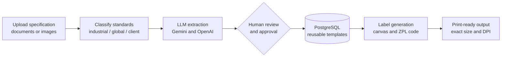

**I build LLM systems that turn messy documents into trusted, structured data,**
**with humans in the loop and in production, not just in notebooks.**

[📄 **Resume (PDF)**](https://github.com/AngelB26/Angel_B_resume/blob/main/Angel_B_AI_Engineer_Resume.pdf) &nbsp;·&nbsp; [💼 **LinkedIn**](https://www.linkedin.com/in/angel-b-asha/) &nbsp;·&nbsp; [✉️ **Email**](mailto:asha4angelsb@gmail.com)

---

## 🚀 Impact in production

| **95%+** | **20+** | **100+** | **90%+** |
|:---:|:---:|:---:|:---:|
| faster turnaround (2 days → 10-20 min) | industrial specification documents processed | print-ready labels generated | extraction accuracy |

## 🏭 Industrial Document-to-ZPL AI Platform

*Production system at an industrial manufacturing company. I lead the 3-person team and own the architecture, LLM pipeline, and backend. The code is proprietary, so I'm happy to walk through the design in an interview.*

- **Generalized one client's request** into a configurable platform used across manufacturing and automotive standards
- **Human-in-the-loop by design:** nothing is saved until a reviewer approves the extracted data
- **Template reuse:** stores approved extractions and layouts, so repeat requests skip re-extraction and cut LLM API cost
- **Verified in the real world:** printed dimensions and DPI checked against a physical scale

## 🛠️ Tech stack

| | |
|---|---|
| **LLMs** | Google Gemini API · OpenAI GPT API · prompt engineering · structured extraction |
| **Document AI** | OCR · OpenCV · document classification |
| **Machine learning** | scikit-learn · XGBoost · LightGBM · CatBoost · HDBSCAN |
| **Data and backend** | Python · SQL · PostgreSQL · SQLAlchemy |
| **Tools** | Docker · Git · Pytest · Streamlit |

## 🌱 Currently learning

- RAG: embeddings, vector databases, and retrieval evaluation
- FastAPI and cloud deployment
- Agent orchestration with LangGraph

## ✍️ Writing

I write about AI and machine learning on [Medium](https://medium.com/@asha4angelsb).

## 🤝 Let's connect

I'm looking for **AI / GenAI engineer roles in the UAE**. My availability and visa details are on my resume.

